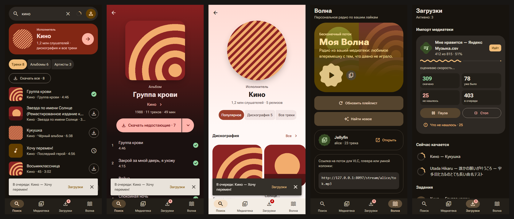

# 🎧 PiMusic — домашний музыкальный сервис

Свой «Spotify» для себя и друзей на любом Linux-сервере с Docker или Podman: **Jellyfin 10.11** как медиасервер,
**Soulseek** (slskd + sockseek), **spotDL** и **yt-dlp** как источники, **Telegram-бот** и **Mini App** (Material 3
Expressive) для управления, приложения для **Windows** и **Android**.

Раздельные медиатеки для друзей, MP3 320 kbps с аккуратными тегами ID3v2.4, обложками 1000×1000, синхронными
текстами, интернет-радио и собственная «Моя Волна».

<p align="center"></p>

> Название осталось от первой версии, которая жила на Raspberry Pi. Сейчас это обычный набор контейнеров: подойдёт
> мини-ПК, NAS, домашний сервер или VPS (x86_64 или arm64).

## Возможности

- **Загрузка по запросу**: «Исполнитель - Название», ссылки Spotify/YouTube/SoundCloud/Bandcamp, импорт медиатеки
  из CSV (Spotify, Яндекс Музыка и др.). Каскад источников: Soulseek → spotDL → yt-dlp.
- **Один файл — много медиатек**: общий кэш и жёсткие ссылки в личные медиатеки Jellyfin, дубликаты не качаются.
- **Теги и тексты**: MusicBrainz (+ iTunes), обложки, ReplayGain, синхронные тексты (LRCLIB, syncedlyrics).
- **Свои файлы**: загрузка через бота или Mini App, опознание по тегам, AcoustID и имени файла.
- **«Моя Волна»**: плейлист по лайкам и прослушиваниям, бесконечный живой поток, рекомендации Last.fm/Deezer.
- **Mini App / PWA**: поиск, медиатека, плеер с эквалайзером, очередь, плейлисты (в том числе общие), офлайн.
- **Приложения**: Windows — нативный клиент WinUI 3 в стиле Windows 11 (плейлисты, «Моя Волна», радио, эквалайзер,
  загрузки, офлайн, трей и медиаклавиши; прежняя оболочка на Tauri — в выпуске 1.0.0) и Android (Kotlin + Compose, Media3).
  Вход — подтверждением в Telegram, без паролей.
- Обычные клиенты Jellyfin тоже работают: веб-плеер, **Finamp**, **Symfonium**, Jellyfin для Android/iOS.
- **API для своих клиентов**: [`docs/api/README.md`](docs/api/README.md), справочник OpenAPI 3.1.

## Требования

- Linux-сервер (x86_64 или arm64), от 2 ГБ ОЗУ (лучше 4 ГБ), место под музыку. Вся папка данных (`DATA_DIR`) —
  на **одном разделе**: на этом держатся жёсткие ссылки.
- Docker с compose v2 **или** Podman с `podman-compose` (или `docker-compose` через сокет Podman). На Debian/Ubuntu без
  Docker `install.sh` поставит его сам (пакеты дистрибутива `docker.io`).
- Telegram-бот (токен от [@BotFather](https://t.me/BotFather)) и аккаунт Soulseek (если ника ещё нет — сеть
  зарегистрирует его при первом входе).
- Необязательно: ключ [Last.fm API](https://www.last.fm/api/account/create) для «Моей Волны», ключ
  [AcoustID](https://acoustid.org/new-application), свой домен с HTTPS для Mini App и приложений.

## Установка

```bash
# 1. скачать проект на сервер (например, в /opt/pimusic)
sudo git clone https://github.com/iKriu/pimusic-server.git /opt/pimusic
cd /opt/pimusic

# 2. создать и заполнить .env (блок «ОБЯЗАТЕЛЬНО»)
sudo cp .env.example .env && sudo nano .env

# 3. установка
sudo bash install.sh
```

Первый запуск занимает 5–25 минут: скачиваются образы и из исходников собирается sockseek. В конце скрипт печатает
ссылки, логины и пароли Jellyfin и slskd и сохраняет их в `$DATA_DIR/state/CREDENTIALS.txt`
(по умолчанию `DATA_DIR=/srv/pimusic` — поменяйте в `.env` до установки, если данные должны лежать в другом месте).

Что делает `install.sh`:

1. Проверяет `.env` и генерирует недостающее: API-ключ slskd, пароль веб-панели, второй Soulseek-аккаунт для
   sockseek, адрес сервера, PUID/PGID, часовой пояс.
2. Находит Docker/Podman и compose (на Debian/Ubuntu без Docker — ставит его). Образы Jellyfin и slskd берутся с
   **ghcr.io**, база образа бота — образ Jellyfin, поэтому Docker Hub не нужен.
3. Создаёт каталоги в `DATA_DIR` и проверяет, что жёсткие ссылки работают; поднимает лимиты inotify для Jellyfin.
4. Поднимает Jellyfin и slskd и через REST API проходит мастер Jellyfin (пока он не пройден, Jellyfin слушает только
   localhost), выпускает API-ключ для бота, создаёт медиатеку администратора и M3U-тюнер радио.
5. Запускает бота и регистрирует systemd-сервис `pimusic`, чтобы всё стартовало после перезагрузки.

Повторный запуск `sudo bash install.sh` безопасен: так делается обновление (`git pull` + `install.sh`) или починка.

**Podman.** С `podman-compose` всё работает как есть. С `docker-compose` поверх сокета Podman запустите установку с
адресом сокета: `sudo DOCKER_HOST=unix:///run/podman/podman.sock bash install.sh` (он попадёт и в службу systemd).
Если контейнерам нужен HTTP(S)-прокси или своя сеть — положите рядом `docker-compose.override.yml`.

**Лимиты ресурсов** контейнеров (память/процессор) заданы в `docker-compose.yml` с запасом и меняются в `.env`
(`JELLYFIN_MEM_LIMIT`, `BOT_MEM_LIMIT`, `*_CPUS`).

### Telegram, Mini App и домен

- Бот работает сразу после установки: `/register <INVITE_CODE> логин пароль` создаёт аккаунт Jellyfin и личную
  медиатеку. Коды раздавайте только друзьям.
- **Mini App** (кнопка «🎵 PiMusic» слева от поля ввода) Telegram открывает только по **HTTPS**. Нужен домен и обратный
  прокси с сертификатом (nginx, Nginx Proxy Manager, Caddy, Traefik): `/app/`, `/api/`, `/stream/` → бот `:8097`,
  остальное → Jellyfin `:8096`. Пример — [`deploy/nginx.example.conf`](deploy/nginx.example.conf).
  Затем в `.env`: `STREAM_PUBLIC_URL=https://music.example.com`, `TRUSTED_PROXIES=<IP прокси>/32`, перезапуск бота.
- Без домена всё остальное работает в локальной сети: Jellyfin `http://<IP>:8096`, Mini App как PWA
  `http://<IP>:8097/app/`, приложения с адресом `http://<IP>:8097`.

### Порты

| Порт | Что | Наружу |
|---|---|---|
| 8096/tcp | Jellyfin | через обратный прокси |
| 8097/tcp | бот: Mini App, API, потоки | через обратный прокси |
| 5030/tcp | веб-панель slskd | только локальная сеть (лучше — SSH-туннель) |
| 50300/tcp, 50301/tcp | входящие Soulseek (slskd, sockseek) | по желанию, для скорости |
| 7359/udp | автообнаружение Jellyfin | только локальная сеть |

### Обслуживание

В [`deploy/`](deploy) — необязательные systemd-таймеры: ночная резервная копия (`backup/`: БД, конфиги, `.env`,
снимок медиатеки с жёсткими ссылками, внешняя копия по rsync) и уборка (`maintenance/`: обрывки загрузок slskd,
висячие образы). Пути настраиваются в `/etc/pimusic-backup.conf` и `/etc/pimusic-cleanup.conf`.

## Приложения

Готовые сборки — в [выпусках](../../releases): `PiMusic-<версия>-setup.exe` (Windows 10 2004+/11, нативный клиент;
с 1.1.0) и `PiMusic-<версия>.apk` (Android 8+). При первом запуске приложение спрашивает **адрес вашего сервера** (например,
`https://music.example.com`; `http://` — только для адреса в локальной сети), вход — подтверждением в Telegram.
Обновления приложения проверяют сами (из выпусков GitHub). Сборка из исходников — [`apps/README.md`](apps/README.md).

## Как пользоваться

| В Telegram | Что происходит |
|---|---|
| `/register КОД логин пароль` | Создаёт аккаунт Jellyfin, папку `users/<логин>` и личную библиотеку «Музыка · логин» с `EnableAllFolders=false`. Сообщение с паролем бот сразу удаляет. |
| `Radiohead - Weird Fishes` | Скачивает трек каскадом источников. Можно прислать несколько строк. |
| ссылка Spotify (трек, альбом, плейлист) | Читает треклист и качает каждый трек каскадом. Ключи Spotify не нужны. |
| ссылка YouTube, SoundCloud, Bandcamp | Сначала ищет студийную версию в Soulseek, иначе берёт оригинал. DJ-сеты длиннее 15 минут качаются как есть. |
| `/wave [N]` | «Моя Волна»: берёт лайки и самое слушаемое → Last.fm `track.getSimilar` (если Last.fm недоступен — Deezer: связанные артисты и их топ-треки) → скачивает N новых треков. |
| `/mywave` | Обновляет приватный плейлист «Моя Волна» и выдаёт ссылку на бесконечный живой поток. |
| `/radio`, `/radio_add Название \| URL` | Интернет-радиостанции. В Jellyfin их видно в разделе Live TV → Каналы. |
| `/find`, `/delete id` | Поиск по своей медиатеке и удаление треков. |
| `/me`, `/queue` | Аккаунт, ссылки, очередь загрузок. |
| `/status`, `/users`, `/radio_del`, файл cookies.txt с подписью `/cookies` | Команды админа: нужен `ADMIN_TELEGRAM_IDS`. |

Клиенты: веб-плеер `http://<IP>:8096`, **Finamp**, **Symfonium**, Jellyfin для Android/iOS.

### Свои файлы

Пришлите боту аудиофайл (mp3, flac, wav, m4a, ogg, opus… — можно сразу несколько) или загрузите в Mini App
кнопкой «Загрузить файлы». Через бота — до 20 МБ (ограничение Telegram для ботов), через Mini App — до
`UPLOAD_MAX_MB` (300 МБ), не больше 50 файлов за раз.

Сервер сам: проверяет, что это аудио → опознаёт трек (теги файла → AcoustID по звуку, если задан
`ACOUSTID_API_KEY` → MusicBrainz/iTunes по имени файла с проверкой длительности) → кладёт в общий кэш с обложкой,
текстом и ReplayGain. FLAC/WAV и др. перекодируются в MP3 320; MP3 любого битрейта сохраняется как есть
(перекодирование качество не добавит). Если такой трек уже есть — он просто появляется в медиатеке.
Не опознал — бот спросит: ответьте на его сообщение «Исполнитель — Название» (или «Оставить как есть» / «Отмена»).
Пока на диске свободно меньше `UPLOAD_MIN_FREE_GB` (5 ГБ), файлы не принимаются.

**За обратным прокси** большие файлы режет лимит тела запроса nginx (1 МБ по умолчанию) — для `location /api/upload`
нужен `client_max_body_size 1g` и `proxy_request_buffering off`. Готовый пример — [`deploy/nginx.example.conf`](deploy/nginx.example.conf).

Если прокси не в частной сети относительно бота, впишите его адрес в `TRUSTED_PROXIES` (иначе `X-Forwarded-For`
игнорируется и лимиты входа считаются по адресу прокси).

**AcoustID (необязательно, бесплатно).** Опознаёт файлы без тегов и с именами вроде `track01.wav`:
1. https://acoustid.org/new-application — войдите (OpenID/Google), «Register a new application», название любое.
2. Скопируйте *API key* в `.env`: `ACOUSTID_API_KEY=…` и перезапустите бота.
Нужен отпечаток Chromaprint: утилита `fpcalc` (пакет `libchromaprint-tools`) или ffmpeg, собранный с chromaprint.
Если ни того, ни другого нет, шаг пропускается и трек опознаётся по тегам и имени файла.

### Вход вне Telegram: PWA, приложения Windows и Android

Mini App работает и как обычное веб-приложение (PWA) и внутри приложений PiMusic для Windows/Android.
Вне Telegram нужен вход — пароль не используется, вход подтверждается в боте:

1. Приложение показывает «Войти через Telegram» (и QR-код для входа с другого устройства).
2. Ссылка открывает бота: `/start login_…` → сообщение «Войти в PiMusic на новом устройстве?»
   с названием устройства и кнопками **Разрешить** / **Отклонить**. Ссылка живёт 5 минут и срабатывает один раз.
   Если вход начали не вы — нажмите «Отклонить».
3. Приложение получает токен устройства. На сервере хранится только его SHA-256.

`/devices` в боте (и «Настройки → Устройства» в Mini App) — список устройств и выход на любом из них.
Не больше 20 устройств на пользователя: при входе 21-го отключается то, что дольше всех не появлялось.

**Виджет Telegram Login (необязательно).** Кнопка «Войти через Telegram» прямо на странице
(без перехода в бота) работает только на домене, привязанном к боту:

1. @BotFather → `/setdomain` → выберите бота → укажите домен из `STREAM_PUBLIC_URL` (например `music.example.com`,
   без `https://` и пути).
2. В `.env`: `LOGIN_WIDGET=true`, перезапустите бота. Без этого виджет не показывается, остаётся вход через бота.

Приложениям (Tauri, Capacitor) нужен CORS: Origin `tauri://localhost`, `http(s)://tauri.localhost`,
`capacitor://localhost`, `http(s)://localhost` разрешены сразу, свои можно добавить в `CORS_ORIGINS`.

**Установка приложений.** Windows: установщик `PiMusic-<версия>-setup.exe` без подписи кода, поэтому при первом
запуске SmartScreen пишет «Система Windows защитила ваш компьютер» — нажмите **Подробнее → Выполнить в любом случае**
(один раз; обновления ставятся сами). Android: APK, разрешить установку из браузера/файлового менеджера. Дальше оба
приложения обновляются сами из [выпусков GitHub](../../releases) (подробности — `apps/README.md`).

### Безопасность и обслуживание

- **Регистрация**: новый аккаунт — пароль не короче 10 символов. Существующий аккаунт Jellyfin через `/register`
  привязать нельзя (иначе бот стал бы «проверялкой» чужих паролей): исключения — повторная регистрация того же
  Telegram и администратор (`ADMIN_TELEGRAM_IDS`, свои аккаунты). Неудачные попытки ограничены и на логин
  (5 в час), и на весь сервер (30 в час); счётчики хранятся в базе и переживают перезапуск.
- **Секреты** из `.env` после старта убираются из окружения процесса бота; дочерние процессы (yt-dlp, ffmpeg,
  spotDL, sockseek) их не получают. Логин/пароль Soulseek для sockseek — в файле `state/sockseek.conf` (права 0600),
  а не в командной строке. Ключи Spotify (`SPOTIFY_CLIENT_ID/SECRET`) spotDL по-прежнему получает аргументами —
  это ключи приложения Spotify, а не учётная запись; не задавайте их, если это важно.
- **Ссылки пользователей** (yt-dlp, радио, обложки) проверяются по DNS: если имя указывает на адрес локальной сети,
  шлюза контейнеров, CGNAT и т.п. — запрос не выполняется (в том числе после редиректов).
- **Очередь загрузок**: не больше 2000 треков одного пользователя одновременно; при свободном месте меньше
  `UPLOAD_MIN_FREE_GB` новые загрузки не ставятся.
- **Сверка с плеером** (трек удалили в Jellyfin/Finamp): удаляется только то, чего нет два прохода подряд (≥ 10 мин);
  если папки медиатек нет или у пользователя «пропало» больше 20 % (и больше 10) треков — проход пропускается
  с ошибкой в логе (это сбой диска, а не удаление).
- **Soulseek раздаёт `/media/share`** — жёсткие ссылки на треки кэша, кроме личных загрузок пользователей
  (бот ведёт её сам и сверяет при старте). slskd видит только `media/incoming/slskd` (запись) и `media/share`
  (только чтение). При обновлении уже установленного сервера: `mkdir -p $DATA_DIR/media/share` до перезапуска.
- **`TRUSTED_PROXIES`**: по умолчанию доверяется только localhost — впишите адрес своего reverse-proxy.

## Как это устроено

```
Telegram ─► bot ─┬─► slskd REST API (поиск/батч-загрузка, видно в веб-панели :5030)
                 ├─► sockseek (второй аккаунт Soulseek, если slskd не нашёл)
                 ├─► spotDL (метаданные Spotify + YouTube Music)
                 └─► yt-dlp (YouTube / SoundCloud / Bandcamp)
                        │
                        ▼  ffmpeg → MP3 CBR 320 (MP3 CBR 320 остаётся без перекодирования; FLAC → 320)
                 MusicBrainz (+ iTunes) → mutagen ID3v2.4 → обложка (APIC + cover.jpg)
                 LRCLIB / syncedlyrics → USLT + SYLT + .lrc
                        │
     /media/library/<Исполнитель альбома>/<Альбом (Год)>/01 Трек.mp3   ← один физический файл
                        │  жёсткие ссылки (hardlink)
     /media/users/<логин>/…  ← личные медиатеки Jellyfin (у каждого своя)
```

* **Экономия места.** Если пятеро друзей скачают один и тот же трек, на диске будет один файл и
  пять жёстких ссылок. Повторный запрос отдаётся мгновенно из кэша. Дубликаты ловятся по
  MusicBrainz ID, ISRC и нормализованной паре «артист|название».
* **Теги.** TIT2, TPE1 (несколько значений — Jellyfin делит артистов корректно), TPE2 (исполнитель
  альбома, поэтому треки с feat. и сборники не распадаются), TALB, TRCK n/N, TPOS d/D, TDRC и TDOR
  (год оригинального выхода, а не переиздания), TCON, TSRC, TPUB, TCMP, MusicBrainz Track, Album,
  Artist, Album Artist и Release Group Id, UFID.
* **Выбор релиза.** Предпочитается оригинальный студийный альбом: официальный, без live и
  compilation, не бокс-сет и не делюкс, самый ранний. Каверы других исполнителей отсекаются по
  MBID артиста.
* **Тексты.** Сначала LRCLIB (точное совпадение по длительности), затем syncedlyrics (Musixmatch,
  NetEase…). Текст пишется в `.lrc` рядом с файлом (Jellyfin читает его сам) и в теги USLT/SYLT.

### Радио и «Моя Волна»: важная оговорка про `.strm`

В Jellyfin 10.11 файлы `.strm` **внутри музыкальных библиотек не воспроизводятся**: это
подтверждённая проблема [jellyfin#8201](https://github.com/jellyfin/jellyfin/issues/8201),
исправлять её разработчики не планируют. Поэтому:

* **Интернет-радио** подключено официальным способом: M3U-тюнером Live TV (файл
  `/media/radio/radio.m3u`, бот обновляет его по `/radio_add`). Файлы `.strm` тоже создаются в
  `/media/radio/strm/`: их можно открыть в VLC или Symfonium.
* **«Моя Волна»** работает в трёх формах:
  1. приватный плейлист Jellyfin «Моя Волна» на 100 треков. Он пересобирается каждые 6 часов по
     лайкам (IsFavorite), прослушиваниям, любимым жанрам и артистам, без повторов и без одного
     артиста подряд, и работает в Finamp, Symfonium и веб-клиенте;
  2. живой бесконечный поток `http://<IP>:8097/stream/<логин>/<токен>.mp3`: ffmpeg с теми же
     весами, один энкодер на пользователя, раздача всем слушателям. Ссылку даёт `/mywave`;
  3. по желанию — канал Live TV (`WAVE_IN_LIVETV=true`). Учтите, что каналы Live TV видны всем
     пользователям.

## Известные особенности (проверено на живой системе)

* **Last.fm API может быть заблокирован по региону** (ответ 403, `error 11`, даже с правильным ключом) — тогда
  «Моя Волна» сама переключается на Deezer API. Раз в час бот снова пробует Last.fm.
* **Jellyfin 10.11 находит новые файлы только при полном сканировании** (`/Library/Refresh`: инкрементальное,
  секунды). Бот запускает его через ~15 с после последнего добавленного трека, поэтому трек появляется в плеере
  примерно через полминуты.
* **Плейлист «Моя Волна» пересоздаётся при каждом обновлении** (раз в 6 часов и после `/wave`): менять состав
  чужого плейлиста API-ключом Jellyfin 10.11 не разрешает. Если клиент закрепил старый плейлист, обновите список.
* **sockseek собирается из исходников при установке** (несколько минут). Если сборка не удалась, бот работает
  через slskd, spotDL и yt-dlp, а в логе сборки будет `WARNING: sockseek НЕ собран`.

## Полезное

```bash
cd /opt/pimusic                     # папка проекта (где docker-compose.yml и .env)
docker compose logs -f bot          # логи бота (с Podman — podman-compose … или docker-compose через сокет)
docker compose ps                   # состояние
sudo bash install.sh                # обновление / починка
docker compose pull && docker compose up -d   # обновить Jellyfin и slskd
```

* **Порты на роутере** (по желанию, для скорости Soulseek): 50300/tcp (slskd) и 50301/tcp (sockseek).
* **YouTube требует подтверждения «я не бот».** Отправьте боту `cookies.txt` (экспорт из браузера)
  с подписью `/cookies`.
* **Отдельный диск.** Укажите `DATA_DIR=/mnt/music/pimusic` до установки. Вся папка `media` должна
  лежать на одном разделе: на этом держатся жёсткие ссылки.
* **Честно о качестве.** Soulseek даёт настоящие MP3 320 и FLAC (FLAC → MP3 320). spotDL и yt-dlp
  берут звук с YouTube (~128–160 kbps), и 320 kbps там — только формат контейнера. Поэтому они идут
  в каскаде последними.

## Лицензия

[GNU AGPL-3.0](LICENSE). Если вы запускаете изменённую версию как сервис для других, вы должны дать её пользователям
исходный код. Сторонние компоненты (Jellyfin, slskd, sockseek, spotDL, yt-dlp, шрифт Material Symbols и др.) — под
своими лицензиями.
